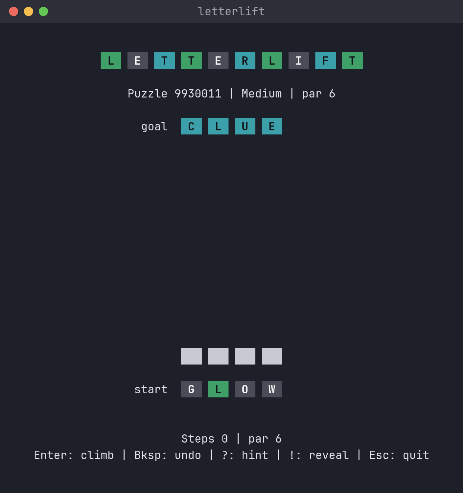
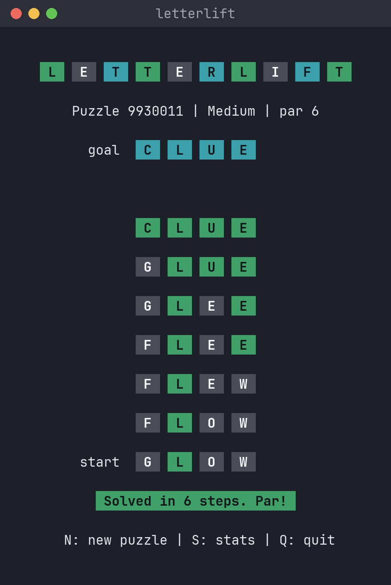
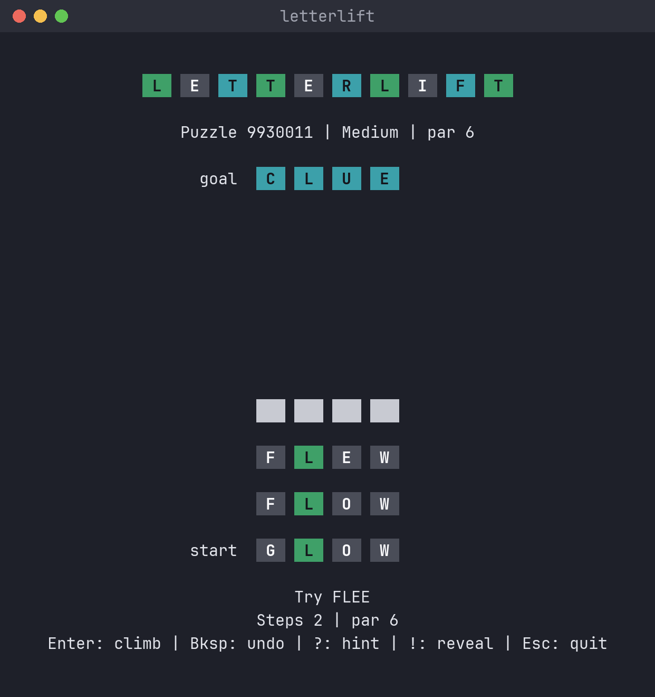
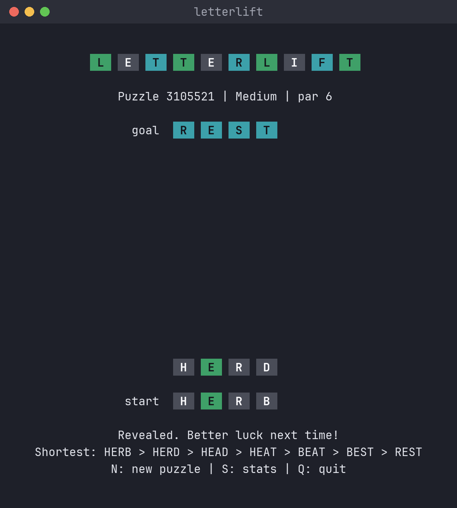
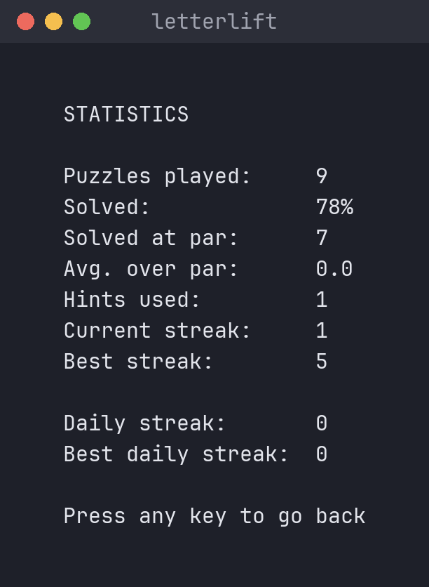
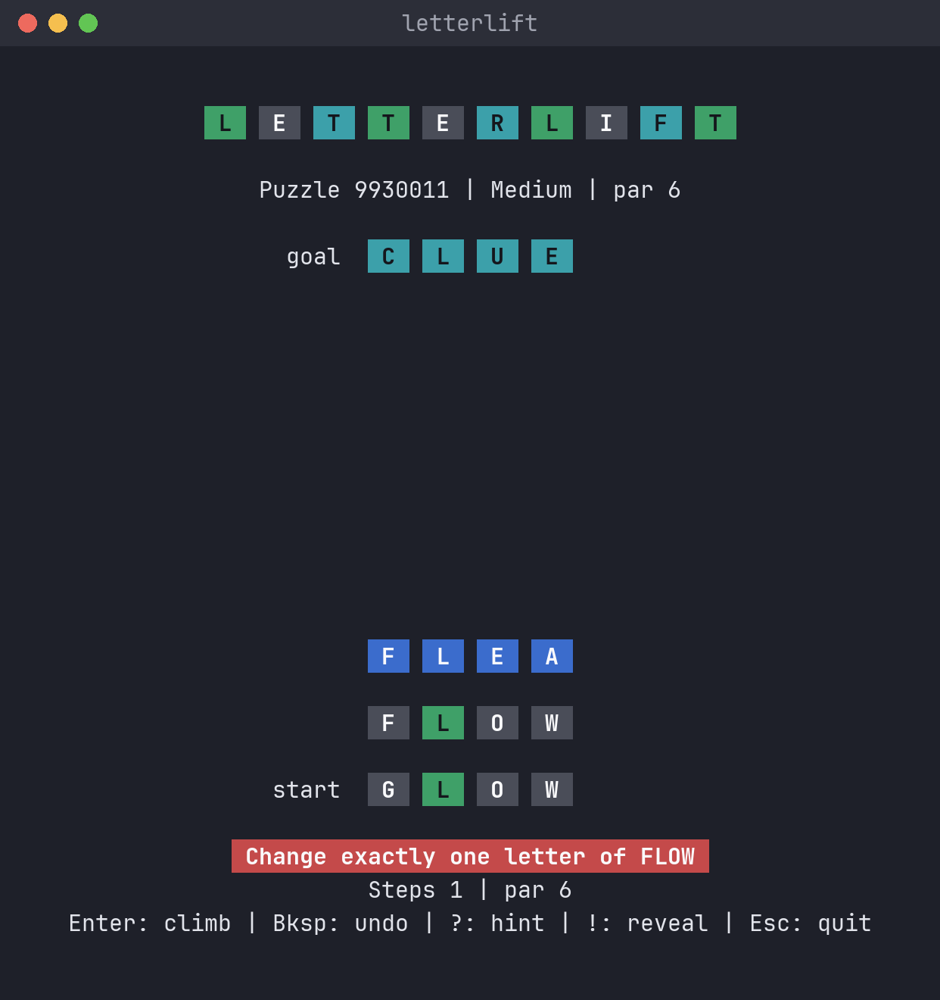
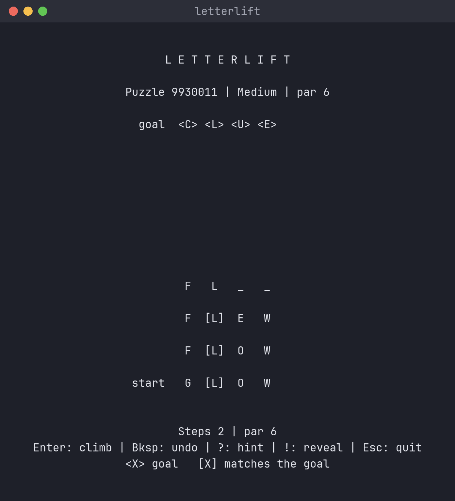
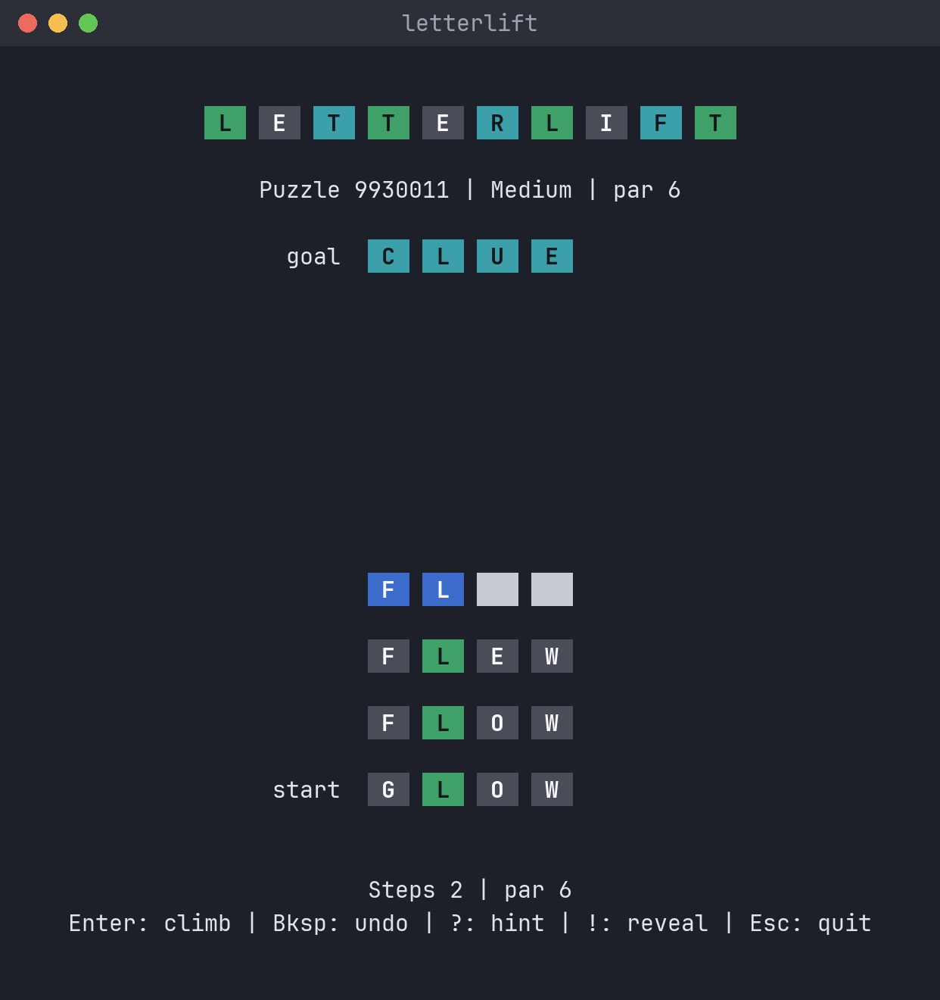

# letterlift

[](https://crates.io/crates/letterlift)
[](https://github.com/pravin/letterlift/actions/workflows/ci.yml)
[](https://github.com/pravin/letterlift/releases/latest)
[](LICENSE)

**Climb from one word to another, one letter at a time, right in your terminal.**

letterlift is a free, open-source word-ladder puzzle. Turn `GLOW` into `CLUE` by changing one
letter per step, and every step has to be a real word: `GLOW → FLOW → FLEW → FLEE → GLEE →
GLUE → CLUE`. Can you match par, the fewest steps possible? One small binary, no account, no
ads, and it works fully offline, including the daily puzzle.

A sister game to [letterlock](https://github.com/pravin/letterlock).



## Features

- **Daily puzzle, offline**: `letterlift --daily` gives everyone the same puzzle each day,
  chosen from the date, so no internet connection is needed. Keep your daily streak going.
- **Shareable puzzles**: every puzzle has a number. Send it to a friend and they play exactly
  the same one with `letterlift --puzzle <number>`.
- **Par and hints**: par is the shortest possible ladder. Stuck? `?` suggests the next step, and
  after each puzzle you're shown a shortest route to learn from.
- **Three difficulties**, plus 5-letter words for longer climbs
- **Your own puzzles**: `letterlift --from cold --to warm`
- **Accessible**: a no-colour mode that marks tiles with symbols instead of colours
- Runs natively on Linux, macOS and Windows (x86_64 and ARM64), with nothing else to install

## Install

**macOS / Linux** with [Homebrew](https://brew.sh):

```sh
brew install pravin/tap/letterlift
```

**Windows** with [Scoop](https://scoop.sh):

```powershell
scoop bucket add pravin https://github.com/pravin/scoop-bucket
scoop install letterlift
```

**Any platform** with [Rust](https://rustup.rs):

```sh
cargo install letterlift
```

Or download the archive for your system from the
[latest release](https://github.com/pravin/letterlift/releases/latest), extract it, and run
`letterlift` (`letterlift.exe` on Windows). Each archive has a matching `.sha256` checksum file.

> **First run on macOS:** the binaries aren't signed yet, so if you downloaded with a browser,
> macOS may refuse to open the file. Run `xattr -d com.apple.quarantine letterlift` once.
>
> **First run on Windows:** SmartScreen may warn about an unrecognised app. Choose
> **More info → Run anyway**.

## How to play

```sh
letterlift                       # a random medium puzzle
letterlift --daily               # today's daily puzzle
letterlift --difficulty hard     # easy, medium or hard
letterlift --length 5            # 5-letter words
letterlift --puzzle 9930011      # replay a puzzle by its number
letterlift --from cold --to warm # your own puzzle
letterlift --stats               # your statistics
```

The goal word is at the top and your ladder grows up towards it from the start word. Type a
word that changes exactly one letter of the word below it and press **Enter**. Letters that
already match the goal turn green.

| Key | Action |
| --- | --- |
| `a`–`z` | Type a letter |
| `Enter` | Add the word to your ladder |
| `Backspace` | Delete a letter, or take back your last step when the row is empty |
| `?` | Hint: the next word on a shortest route |
| `!` | Reveal a shortest route and end the puzzle |
| `Esc` / `Ctrl+C` | Quit |

After a puzzle: `N` for a new one, `S` for statistics, `Q` to quit. When you quit after a daily
or numbered puzzle, letterlift prints a one-line result you can paste to friends.

**Words:** about 2,600 four-letter and 5,100 five-letter words are accepted. Puzzles always
start and end on common words, and par, hints and routes only go through familiar words, so you
never need an obscure word to make par. If you find one, you might even beat par.

**No colour:** run with `--no-color` or set `NO_COLOR=1`. The goal is shown as `<X>` and
letters that match it as `[X]`.

Statistics are saved to:

- Linux: `~/.local/share/letterlift/stats.json` (respects `$XDG_DATA_HOME`)
- macOS: `~/Library/Application Support/letterlift/stats.json`
- Windows: `%APPDATA%\letterlift\stats.json`

## Screenshots

| | |
| :---: | :---: |
|  |  |
| Solved at par | A hint |
|  |  |
| Revealing the answer | Statistics |
|  |  |
| A step that changes two letters | No-colour mode |
|  | |
| Mid-puzzle | |

## Development

```sh
cargo test
cargo run -- --from cold --to warm
```

### Word lists

`src/words/` holds three lists for each word length:

- `allowed-N.txt`: every word accepted as a step
- `familiar-N.txt`: words par, hints and the shown route may use
- `common-N.txt`: words a puzzle may start or end on

They are generated by `scripts/build-words.py` from
[SCOWL](http://wordlist.aspell.net/) (Spell Checker Oriented Word Lists, the lists behind
Debian's `/usr/share/dict/words`), using the [`wordfreq`](https://pypi.org/project/wordfreq/)
package to rank words by how common they are. Names, places, slurs and crude words are
filtered out of puzzles, hints and routes. To regenerate:

```sh
pip install wordfreq
curl -LO https://downloads.sourceforge.net/project/wordlist/SCOWL/2020.12.07/scowl-2020.12.07.tar.gz
tar xzf scowl-2020.12.07.tar.gz
python scripts/build-words.py scowl-2020.12.07
```

Changing the lists changes which puzzle each number and date produces.

### Releasing

1. Bump `version` in `Cargo.toml`, run `cargo build` to update `Cargo.lock`, and commit.
2. Tag and push, e.g. `git tag v0.2.0 && git push origin v0.2.0`.
3. The [Release workflow](.github/workflows/release.yml) builds binaries for Linux, macOS and
   Windows (x86_64 and ARM64) and publishes a GitHub release with checksums.
4. Publish to crates.io: `cargo publish`.
5. Update the package managers with the new version and the SHA-256 values from the release's
   `.sha256` files:
   - Homebrew: `Formula/letterlift.rb` in [pravin/homebrew-tap](https://github.com/pravin/homebrew-tap)
   - Scoop: `bucket/letterlift.json` in [pravin/scoop-bucket](https://github.com/pravin/scoop-bucket)

To test the builds without publishing, run the Release workflow manually from the Actions tab.

## License

GPL-3.0-or-later. See [LICENSE](LICENSE).

The word lists are derived from SCOWL, Copyright 2000-2018 by Kevin Atkinson and others; see
[src/words/SCOWL-Copyright.txt](src/words/SCOWL-Copyright.txt) for its full notice.
